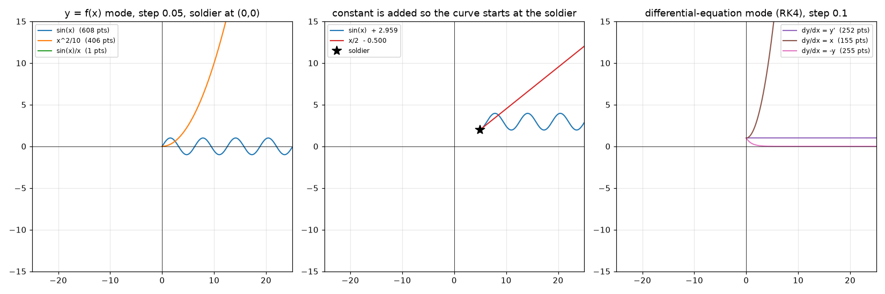

# Graphwar II — 弹道曲线点序列 / trajectory point generator

> **中文一句话**：逆向 Graphwar II（Godot 4.7 + Rust GDExtension）里"把玩家输入的函数变成子弹飞行点序列"的那段代码，
> 给出与二进制**逐位相同**的 Python 复刻，并记录了完整的逆向与验证方法。
>
> **In one line**: a bit-exact Python reimplementation of the routine that turns a
> player-typed function into the bullet's trajectory points in Graphwar II, recovered
> by static analysis plus an instruction-level emulator used as a test oracle.

```
typed text  ──parser──▶  prefix token list  ──evaluator──▶  f(x)  ──sampler──▶  [(x, y), ...]
            (0x4ed670)                      (0x4eb9d0)              (0x3c2530)
```

* `graphwar_curve.py` — the reimplementation (parser + evaluator + sampler). **Standard library only.**
* `REPORT.md` — the full write-up (Chinese): key addresses, the token enum, the grammar,
  the sampler in pseudocode, the GW1↔GW2 comparison, verification and limitations.
* `analysis/` — every script used to get there (ELF/capstone index, unicorn oracle, diff tests).

Analyzed target: **Graphwar II 0.1.0, Linux x86-64** (`libgraphwarrust.so`, Godot 4.7 GDExtension).

---

## The algorithm in 20 lines

```python
pts = [(x0, y0)]                     # first point = the firing soldier
x, y = (±x0, y0)                     # flip -> mirror x (fire to the left)
n = (200.0 / step) as i32            # point budget; step = 0.01 on the server
for _ in range(n):
    lo, hi = x, x + step
    for _ in range(100):             # bisect for "chord length == step"
        mid = (lo + hi) / 2
        L = sqrt((mid - x)**2 + (F(mid) - y)**2)      # chord, not arc length
        if |L - step| < 0.001:  break                 # converged
        if L > step: hi = mid
        else:        lo = mid
    if not converged: break          # give up: the curve ends here (no bad point!)
    if |mid| > 25 or |F(mid)| > 15 or isnan: break     # hard plane bounds
    pts.append((±mid, F(mid)));  x, y = mid, F(mid)

# F(x) = f(x) + c with c = y0 - f(±x0)   (so the curve passes through the soldier)
# mode "y = f(x)" : F(x)    = eval(tokens, x, 0, 0)
# mode "dy/dx = f" : RK4 steps, F uses eval(tokens, x, y, 0)
```

Notes that surprise people:

* the spacing is a **chord** length, not equal-Δx and not arc length;
* the sampler **never accepts a bad point** — if the bisection cannot converge it stops
  the whole curve (this is what makes GW2 stable where GW1 oscillates);
* `^` is **left-associative** (`2^3^2 = 64`), `log` is log10, `n`/`pi`/`π` are all π;
* `y'` (the third variable) is **always 0** in the shipped build — GW2 dropped the
  second-order ODE mode that GW1 had.

---

## Quick start

```bash
python3 graphwar_curve.py "sin(x)" --start 5 2            # 0.01 step, curve passes the soldier
python3 graphwar_curve.py "y'" --ode --start 0 1          # dy/dx = y  ->  e^x
python3 graphwar_curve.py "x^2/10" --start -6 -2 --csv points.csv
```

```python
import graphwar_curve as gw

gw.parse_function("2*x+1")          # [3, 6, (17, 2.0), 0, (17, 1.0)]   prefix tokens
gw.evaluate(gw.parse_function("sin(x)"), 0.5)    # 0.479425538604203
gw.correction_text(gw.parse_function("sin(x)"), 5, 2)   # ' + 2.959'  (bottom-right corner)
gw.shot_points("sin(x)", 5, 2)      # the exact point list the game would produce
```



---

## Repository layout

| path | what |
|---|---|
| `graphwar_curve.py` | the deliverable: parser + evaluator + sampler (+ CLI) |
| `REPORT.md` | full reverse-engineering write-up (Chinese) |
| `docs/*.png` | plots produced by the reimplementation |
| `analysis/elf.py` | minimal ELF64 reader |
| `analysis/build_index.py` | capstone sweep + rip-relative cross-reference index |
| `analysis/dz.py` | disassembly / xref / function-boundary queries |
| `analysis/emu.py`, `analysis/gwemu.py` | **unicorn oracle**: calls functions inside the real `.so` |
| `analysis/gw1_model.py`, `analysis/gw1_parser.py` | ports of Graphwar **1**'s Java algorithm, for comparison |
| `analysis/difftest.py`, `fuzz.py`, `difftest_parser.py`, `final_verify.py` | differential tests (model vs. binary) |
| `analysis/discontinuity.py` | discontinuity / steep-slope / ε experiments behind REPORT §5.7 |
| `analysis/regen.sh` | rebuilds every artifact that is **not** committed |

## Verification

The reimplementation is not "believed to be right", it is **checked bit for bit**:
`analysis/emu.py` maps the real `.so` into unicorn and executes the actual machine code
(often the *same* bytes that shipped), and every test compares the full point array
(float equality, NaN positions, point count and order).

| test | cases | result |
|---|---|---|
| `difftest.py` | 704 point sequences | 0 differences |
| `fuzz.py` | 1200 sequences from random expression trees | 0 differences |
| `final_verify.py` | 648 sequences end-to-end (text → tokens → points) + 40 correction strings | 0 differences |
| `difftest_parser.py` | 90 expressions (73 valid + 17 malformed) | 0 differences |

So: **observational equivalence on ~2550 trajectories**, not a formal proof — see
"Known limitations" in `REPORT.md` §6.

## Re-running the reverse engineering

The game files are **not** redistributed here. Put your own copies in the repo root:

```
Graphwar.x86_64     Graphwar.pck     libgraphwarrust.so
```

then

```bash
python3 -m venv .venv && .venv/bin/pip install -r requirements.txt
./analysis/regen.sh          # index, function table, strings, (optional Ghidra dumps), .pck
.venv/bin/python analysis/fuzz.py 300 7
```

`graphwar_curve.py` works without any of that.

## Disclaimer

**Unofficial.** This project is not affiliated with, endorsed by, or sponsored by the
author of Graphwar. The name "Graphwar" is used descriptively, to say what is being
analysed.

* Graphwar II is a **commercial product** (paid on Steam, free with paid cosmetics on
  Android). Nothing here redistributes, replaces or modifies any part of it: no binaries,
  no assets, no network protocol, and nothing that circumvents licensing, purchases or
  advertising. `.gitignore` enforces that and `analysis/regen.sh` rebuilds the derived
  files from *your own* copy of the game.
* This is **an offline calculator and a research write-up**, not an in-game assistant.
  It does not read the game's memory, hook the running client, or automate play.
  Please don't use it to build automated tools for online matches — that's against the
  spirit of the game and the author has not endorsed it.
* If the author of Graphwar objects to any material here, it will be removed on request.

## Legal / license

* The repository is **GPL-3.0-or-later** (`LICENSE`): that keeps it compatible with the
  Graphwar 1 sources it builds on, and it means anyone may reuse this analysis.
  It grants no rights over the game itself.
* `analysis/gw1_model.py` and `analysis/gw1_parser.py` are ports of Graphwar 1, which is
  **GPL-3.0** (© Lucas Catabriga Rocha) — see `NOTICE.md`.
* Graphwar, Graphwar II and their assets remain the property of their author.

## Credits

* Graphwar 1 source (GPLv3) — Lucas Catabriga Rocha
* Graphwar 2 — the author of the Rust/GDExtension rewrite
* Reverse engineering, this repo — see `NOTICE.md`
