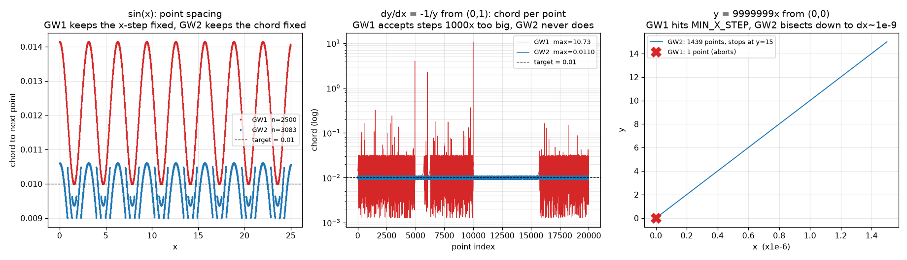

# Graphwar II 弹道曲线点序列 —— 逆向报告

目标：找出游戏如何把玩家输入的“函数”变成子弹飞行的**点序列**（即屏幕上那条曲线的采样点），
并给出可复现的等价实现。

产物：

| 文件 | 说明 |
|---|---|
| `graphwar_curve.py` | 完整、可直接使用的 Python 复刻（解析器 + 求值器 + 点序列生成 + 修正常数） |
| `analysis/` | 逆向过程中用到的全部脚本（ELF/capstone 索引、unicorn 模拟器、差分测试） |
| `analysis/gw1_model.py`, `analysis/gw1_parser.py` | GW1 的步进 / 解析器等价模型（用于 §5 对比） |
| `docs/curves.png`, `docs/spacing.png` | 复刻实现画出来的曲线 |
| `docs/gw1_vs_gw2.png` | GW1 与 GW2 的步长行为对比 |

复刻精度：**与二进制逐位相同**（浮点结果完全相等，包括点的个数与顺序），
已用 2552 条曲线（含 1200 条随机表达式）逐点差分验证，浮点结果完全一致。

---

## 0. TL;DR —— 算法本体

```
输入：函数文本 text、开火士兵坐标 (x0, y0)、步长 step（服务端固定用 0.01）、
      方向 flip（向左开火）、模式 mode

1) 解析  text --正则--> 词法单元 --递归下降--> 前缀(Polish)记号 token 列表
      · 正则： [0-9]*\.?[0-9]+|\(|\)|x|y'|y|\+|-|\*|/|\^|sqrt|log|abs|sin|cos|tan|ln|n|exp|e
      · 预处理：整串转小写；"pi" 与 "π" 都替换成 "n"（n 就是 π）
      · 运算符优先级：函数 > ^(左结合) > 一元负号(比 ^ 松) > * /(含隐式乘法) > + -
      · 常量表：e = 2.718281828…，n = π = 3.141592653…

2) 修正  常数 c = y0 - f(x0')，其中 x0' = flip ? -x0 : x0
      实际射击用的函数是 f(x) + c —— 这让曲线一定穿过开火的士兵。
      屏幕上右下角显示的 " + 0.591" / " - 1.000" 就是它（保留 3 位小数）。
      表示成前缀记号就是 [ADD, CONST(c)] ++ tokens。

3) 采点  calculate_path(tokens, x0, y0, step, flip, ode)
      pts = [(x0, y0)]                      # 第一个点就是士兵位置
      x = -x0 (flip 时) 否则 x0 ;  y = y0
      n = (200.0 / step) 转 i32（饱和转换）；若 < 2 则取 1
      重复最多 n 次：
          lo = x ;  hi = x + step
          重复最多 100 次：                  # 二分找“弦长 = step”的下一个点
              mid = (lo + hi) / 2
              弦长 L = hypot(mid - x, F(mid) - y)      # 注意 hypot 是 sqrt(a²+b²)
              若 |L - step| < 0.001: 收敛
                  若 mode 为普通函数：再做一次半步校验（见 §3.2）
                  检查 |x| ≤ 25、|y| ≤ 15、非 NaN，然后 pts.push((±mid, F(mid)))
                  x = mid ; y = F(mid) ; 进入下一个点
              否则：L > step 或 NaN -> hi = mid ；否则 lo = mid
          若 100 次仍未收敛（例如函数在该处无解）：
                  放弃，曲线到此为止（通常就只剩起点 1 个点）

      mode = 普通函数：     F(x) = eval(tokens, x, 0, 0)              —— y = f(x)
      mode = 微分方程：     dy/dx = eval(tokens, x, y, 0)  (RK4 积分)
```

一句话：**游戏沿曲线做“等弦长”追赶（自适应二分），弦长约 step，点最多 (200/step) 个，
超出棋盘 |x|≤25、|y|≤15 或出现 NaN 就停**。

> 与 GW1 的差别、以及 GW2 为什么不再出现“步长过短崩溃 / y'=-1/y 乱跳”，见 §5。

---

## 1. 目标二进制

| 文件 | 说明 |
|---|---|
| `Graphwar.x86_64` | Godot 4.7 导出模板（stripped ELF） |
| `Graphwar.pck` | Godot 资源包（v4，692 个文件，其中 52 个 `.gdc` 全是 UI 小脚本，**不含游戏逻辑**） |
| `libgraphwarrust.so` | **核心**：GDExtension（Rust + godot-rust），所有游戏逻辑都在这里 |

- `.pck` 里的脚本（zstd 压缩的 GDScript 字节码）只有按钮/布局之类，逻辑全在 Rust 侧。
- Rust 库是 stripped 的，但保留了 panic 时的 `src/xxx.rs:line` 字符串，可以据此把代码定位到源文件：

```
src/graphwar_function_input.rs      函数解析器
src/graphwar_path_calculator.rs     曲线点序列生成   ← 核心
src/graphwar_shot_calculator.rs     开火结算（调用上面的生成器）
src/graphwar_function_manager.rs    函数管理与存储
src/graphwar_plane.rs               坐标系/绘制
```

### 关键地址

| 地址 | 作用 |
|---|---|
| `0x4ed670` | `parse_function`（文本 → 前缀 token 列表） |
| `0x4eb9d0` | `eval(tokens, x, y, dy)`（递归下降求值） |
| `0x4eb830` | 常量折叠（解析后把纯常量表达式折成一个 CONST） |
| `0x3c2530` | **`calculate_path`（点序列生成）** |
| `0x3c5f70` | 计算并格式化修正常数（右下角那行字） |
| `0x3c2bc0` | 开火结算主函数（12 KB，调用上面这些） |

### 枚举 `Function` 的变体（判别值 = token 编号）

`.rodata` 里直接有这些变体名的连续字符串：
`VAR_X VAR_Y VAR_DY ADD (SUB) UNARY_MINUS (MUL) DIVIDE POW LOG LN EXP ABS SIN COS TAN CONST LEFT_BRACKET RIGHT_BRACKET`

| id | 记号 | 含义 | id | 记号 | 含义 |
|---|---|---|---|---|---|
| 0 | `x` | 自变量 | 9 | `sqrt` | 平方根 |
| 1 | `y` | 因变量 | 10 | `log` | **log10** |
| 2 | `y'` | 第三变量（见 §3.4） | 11 | `ln` | 自然对数 |
| 3 | `+` | | 12 | `exp` | |
| 4 | `-` | | 13 | `abs` | |
| 5 | `neg` | 一元负号 | 14 | `sin` | |
| 6 | `*` | | 15 | `cos` | |
| 7 | `/` | | 16 | `tan` | |
| 8 | `^` | 幂 | 17 | `const` | 常量（token 里带 f64） |

token 在内存里是 16 字节：`{tag: u64, value: f64}`。

---

## 2. 解析：文本 → 前缀记号

```
parse(s):
    s = s.lower()
    s = s.replace("pi", "n").replace("π", "n")     # 0x4ed7ce / 0x4ed831 处的两次 replace
    对正则 r"[0-9]*\.?[0-9]+|\(|\)|x|y'|y|\+|-|\*|/|\^|sqrt|log|abs|sin|cos|tan|ln|n|exp|e"
    从左到右扫描（其它字符直接忽略）
```

然后按下面的文法递归下降，**输出前缀（Polish）记法**（不用栈，直接就是求值器要的顺序）：

```
expr     := term { ('+'|'-') term }
term     := unary { ('*'|'/'|隐式乘法) unary }
unary    := '-' unary | power
power    := primary { '^' prefixed }         ← 左结合！2^3^2 = (2^3)^2 = 64
prefixed := '-' prefixed | primary
primary  := 数字 | x | y | y' | e | n | '(' expr ')'
          | 函数名 primary                    ← sinx、sin x、sin(x) 都行
```

实测得到的行为（全部与二进制一致）：

| 输入 | token 列表 | 说明 |
|---|---|---|
| `2*x+1` | `+ × 2 x 1` | |
| `x/2/3` | `/ / x 2 3` | `/` 左结合 |
| `2^3^2` | `^ ^ 2 3 2` | `^` **左**结合（= 64，不是 512） |
| `-2^2` | `neg ^ 2 2` | 一元负号比 `^` 松 |
| `2^-3` | `^ 2 neg 3` | `^` 右边可以是负号 |
| `2x`、`2 sin(x)`、`(x)(3)`、`xy` | 都插入一个 `*` | 隐式乘法 |
| `2x^2` | `× 2 ^ x 2` | `^` 比隐式乘法紧 |
| `pi` / `π` / `n` | `const 3.14159…` | |
| `e` | `const 2.71828…` | |
| `y'` | `VAR_DY` | 正则里 `y'` 在 `y` 前 |
| `sin^2(x)` | `× ^ sin 2 x` | 函数没带操作数时就是个“裸算子”记号 |
| `x+` | `+ x const0` | 缺右操作数时 `+`/`-` 补 `const 0` |
| `x*` | `× x` | 其它运算符缺操作数就干脆不补（求值时越界返回 0） |
| `x)` / `(x` / `()` | 括号直接忽略/丢弃 | 不报错 |

> 解析器**不做合法性检查**：非法输入会生成一棵残缺的记号树，求值时缺的算子返回 0。

解析完成后还有一个**常量折叠**（`0x4eb830`）：如果整条式子与 x、y 无关（纯常量），
会用 `x=y=y'=0` 求值后折叠成单个 CONST。

---

## 3. 点序列生成（核心）

### 3.1 函数签名

```rust
fn calculate_path(
    out:  &mut Vec<(f64, f64)>,   // 输出点
    f:    &Vec<Function>,          // 前缀记号
    x0:   f64,                     // 士兵 x（第 1 个 xmm 参数）
    y0:   f64,                     // 士兵 y
    step: f64,                     // 期望的点间距（弦长）
    flip: bool,                    // 向左开火（把 x 取反）
    ode:  bool,                    // 微分方程模式
)
```

### 3.2 普通函数模式（`y = f(x)`）

```
pts = [(x0, y0)]                  # 起点 = 士兵位置，无条件压入
x   = flip ? -x0 : x0
y   = y0
n   = point_budget(step)          # 见 §3.5

while count < n:
    lo, hi = x, x + step          # 在 [x, x+step] 里二分
    for _ in 0..100:
        mid = (lo + hi) * 0.5
        fm  = f(mid, 0, 0)                         # 注意 y、y' 传 0
        L   = sqrt((mid - x)^2 + (fm - y)^2)       # 从“上一个点”到 (mid, f(mid)) 的弦长
        if |L - step| >= 0.001:                    # 未收敛（NaN 也走这里）
            if L > step or isnan(L): hi = mid      # 太长/无效 → 缩上界
            else:                    lo = mid      # 太短   → 抬下界
            continue
        # —— 收敛后二进制还会做一次“半步复核”
        mid2 = (x + mid) * 0.5
        fm2  = f(mid2, 0, 0)
        L2   = sqrt((mid2 - x)^2 + (fm2 - y)^2)
        if L <= L2:                               # 复核不通过
            lo = x                                # 重置下界，继续二分
            continue
        if isnan(fm) or isnan(±mid): break        # 出界/NaN → 整条曲线结束
        if abs(mid) > 25: break
        if abs(fm)  > 15: break
        pts.push((flip ? -mid : mid, fm))
        count += 1
        x, y = mid, fm
        break
    if not accepted: break                        # 100 次二分都没收敛 → 曲线到这里结束
```

要点：

* 追的是 **弦长 ≈ step**，不是 x 方向等距，也不是弧长（Chord，不是 arc length）。
* 二分固定 100 次上限，收敛阈值 0.001；由于阈值不小，实际点距通常略小于 step
  （例如 step=0.1、f=0 时第一段 dx=0.09921875 = 0.1×(1−1/128)）。
* 棋盘坐标范围硬编码：`|x| ≤ 25`、`|y| ≤ 15`（`0x19fbc8` = 25.0、`0x19fd40` = 15.0）。
* **超出范围不是裁剪而是直接终止**，所以曲线永远停在棋盘边界之前一点点。
* `hypot` 是内联实现 `sqrt(a*a+b*b)`（`0x887090`），不是 IEEE 的 `hypot`。
* 二分过程中如果解不出来（例如 `sin(x)/x` 在 x=0、`1/x` 在 x=0、或者曲线与士兵的 y 相距
  超过 step 又无解），整条序列就只有起点一个点——这就是“哑弹”。

### 3.3 微分方程模式（`dy/dx = f(x, y)`）

同样的框架，但每一步用 **RK4** 把 ODE 推进一个 h，再用二分调 h 让弦长 = step：

```
h   = mid - x
k1  = f(x,           y)
k2  = f(x + h/2,     y + k1*h/2)
k3  = f(x + h/2,     y + k2*h/2)
k4  = f(x + h,       y + k3*h)
yn  = y + (h/6) * (k1 + 2*k2 + 2*k3 + k4)
L   = sqrt(h^2 + (yn-y)^2)
… 其余（二分、出界、NaN）与普通模式相同，但**没有**半步复核
```

所以 `dy/dx = y` 从 (0,1) 出发得到 `e^x` 的等弦长采样；`dy/dx = x` 得到抛物线。

### 3.4 关于 `y'`

求值器有三个变量：`x`（xmm0）、`y`（xmm1）、`y'`（xmm2）。
但**生成点序列时第三参数恒传 0**（普通模式和 ODE 模式都是），
所以玩家在游戏里写 `y'` 永远等于 0。ODE 模式只支持 `dy/dx = f(x, y)`，
这与关卡提示文字 “Write a differential equation in terms of x and y” 一致。

### 3.5 点数上限

```c
n = (int)(200.0 / step);     // x86 饱和转换（NaN→0，超界截到 INT_MIN/INT_MAX）
if (n < 2) n = 1;            // 注意不是 max(n,1)，而是 (n>=2) ? n : 1
```
所以 `step = 0.01`（服务端实际用的值）时最多 20000 个点；
真正结束通常是撞到棋盘边界。

### 3.6 修正常数（让曲线穿过士兵）

```
c = y0 - f(flip ? -x0 : x0)        # 0x3c5f70
实际使用的函数 = f(x) + c
UI 右下角显示： c >= 0 ? " + %.3f" % c : " - %.3f" % -c
```
含义：玩家写的曲线在 x0 处未必经过士兵，游戏整体上移 c，
于是子弹一定从士兵身上出发。这也解释了为什么“函数写错了也不会从别处冒出来”。

> 如果不做这个修正，`calculate_path` 会在第一个点处解不出弦长（弦长被竖直偏移主导），
> 直接返回只有起点的一个点——可以据此验证这个修正确实存在。

---

## 4. 调用方：服务端开火结算

`0x3c2bc0`（`graphwar_shot_calculator.rs`）在结算一次开火时：

1. 从 `HashMap<soldier_id, (x, y)>` 里取出开火士兵的位置（`0x3c2f20`）；
2. 从配置结构体里取 `step`（结构体偏移 0 处的 f64）；
   该结构体在服务端的构造点是 `0x4717f7`：`movabs rax, 0x3f847ae147ae147b`，即 **0.01**；
   客户端预览处（`0x3e2d35`）同样用 `0x19f110` = **0.01**；
3. 调用 `calculate_path`（间接调用，函数指针放在 `0x9bac98`）；
4. 得到的点数组随 `FunctionPointsEvent { start_x, start_y, end_x, points }` 广播。

所以**每个点之间的弦长在服务端就是 0.01**（棋盘 50×30，一条长曲线大约 2500～5000 个点）。

---

## 5. GW1 与 GW2 的函数算法对比

GW1 源码（`optimize` 分支）：
`Function/src/Graphwar/Function.java`、`PolishNotationFunction.java`、`GraphServer/Constants.java`。

> 对比用的 GW1 数值模型见 `analysis/gw1_model.py`（只移植 `processRange()` 的数值部分，
> 忽略士兵半径偏移、障碍物碰撞与随机数），解析器模型见 `analysis/gw1_parser.py`。

### 5.1 一句话

| | GW1 | GW2 |
|---|---|---|
| 本质 | **固定 Δx，太大就对半砍**（halving，只有上限、没有目标） | **以弦长为目标做二分**（bisection，有目标、有容差、有迭代上限） |
| 结果 | 点距随斜率漂；砍到下限就放弃；ODE 模式下放弃时**仍接受那个超大的步** | 点距恒定；解不出就**整条曲线干净停下**，绝不接受坏点 |

### 5.2 常量对照

| 量 | GW1（`Constants.java`） | GW2（`.rodata`） |
|---|---|---|
| 步长含义 | 最初 Δx = `STEP_SIZE` = **0.01** | 弦长目标 `step` = **0.01** |
| 收缩判据 | 弦长² > `FUNC_MAX_STEP_DISTANCE_SQUARED` = **0.001**（即弦长 > 0.0316）才砍 | \|弦长 − step\| < **0.001** 才算收敛（`0x19fc78`） |
| 收缩方式 | `tempStepSize /= 2`，次数不限 | `mid = (lo+hi)/2`，**最多 100 次** |
| 下限保护 | `FUNC_MIN_X_STEP_DISTANCE` = **1e-5** | **无**（可以一路二到 2⁻¹⁰⁰） |
| 点数上限 | `FUNC_MAX_STEPS` = **20000**（固定） | `(200.0 / step)` = **20000**（step=0.01 时；随 step 变） |
| 出界判据 | 只靠 `obstacle.collidePoint((int)px,(int)py)`（像素越界返回 true）+ NaN/inf | 每个点入列前硬检查 **\|x\| ≤ 25、\|y\| ≤ 15**、NaN |
| 棋盘 | `PLANE_LENGTH=770px → 50` 游戏单位 → x∈[−25,25]，y∈[−14.6,14.6] | x∈[−25,25]，y∈[−15,15] |
| ODE | `FST_ODE` 一阶 RK4；`SND_ODE` **二阶** RK4（`(y, y')` 向量） | 只有一阶 RK4；第三变量 `y'` **恒传 0** |
| 修正常数 | `offSet = y0 − f(x0)`，在 `setNextValues()` 里**数值相加** | 同一公式，只是把函数文本改写成 `"f(x) + c"` 再**重新解析**（`0x3c5c50` 构造该串，`graphwar_function_manager` 分别解析原串与修正串）。**属于实现方式差异，不是算法差异** |
| 起点 | 沿切向偏移一个士兵半径（为此迭代求 `fireAngle`） | 直接用士兵坐标作首点（半径补偿若存在不在点序列里） |

### 5.3 算法并排

```java
// GW1  processRange()
xs[0] = soldierX; ys[0] = soldierY;
off   = -f(xs[0]) + ys[0];              // 修正常数
for (i = 1; i < 20000; i++) {
    tempStep = 0.01;
    step_once(tempStep);                // ys[i] = f(xs[i]) + off  或 RK4
    for (j = 0; 弦长² > 0.001; j++) {    // 太大就砍半
        if (xs[i]-xs[i-1] <= 1e-5) {    // 砍到底了
            if (NORMAL) endFunc = true; //   普通模式：结束
            break;                      //   ODE 模式：只 break，坏点留下！
        }
        tempStep /= 2;
        step_once(tempStep);
    }
    if (endFunc) break;
    if (collide((int)px,(int)py) || NaN(y) || Inf(y)) break;
}
```

```rust
// GW2  calculate_path()
pts = [(x0, y0)];
for count in 0..n {                     // n = 200/step
    lo = x; hi = x + step;
    for _ in 0..100 {                   // 二分：目标弦长 = step
        mid = (lo+hi)/2;  L = hypot(mid-x, F(mid)-y);
        if |L-step| >= 0.001 { if L>step||NaN { hi=mid } else { lo=mid }; continue }
        if |mid|>25 || |F(mid)|>15 || NaN { return }   // 越界即整条结束
        pts.push(...); x=mid; y=F(mid); break;
    }
    if 未收敛 { return }                 // 100 次解不出 → 曲线到此为止
}
```

差异要点：

1. **GW1 的“自适应”只是安全阀**：只有当弦长 > 0.0316 才砍半；对一个平缓曲线（如 `sin(x)`）
   Δx 一直是 0.01，**点距沿曲线漂**（实测 0.0100–0.0141），而且 0.0316 是“上界”不是“目标”，
   砍一次可能就落到 0.0158——振荡区间宽达 2 倍。
   GW2 每次都二分到 **0.01 ± 0.001**，实测 0.0090–0.0106，点距真正均匀。
2. **收缩方式**：GW1 是“砍半”，从 0.01 砍到 1e-5 最多 10 次就撞上限；
   GW2 是二分，上限 100 次（相对精度 2⁻¹⁰⁰），而且有明确容差，
   收敛后点的弦长误差小于 1%。
3. **GW1 的守卫在 ODE 模式下是“假止损”**：`break` 只是跳出砍半循环，
   那个**超大的一步仍然被计入**——这就是 `y' = -1/y` 在 y≈0 附近剧烈乱跳的直接原因。
   GW2 只要 100 次内不收敛就 `return`，**一个坏点都不会输出**。
4. **GW1 无坐标硬边界**：它靠 `obstacle.collidePoint((int)px,(int)py)` 顺便挡一下，
   一旦这一帧没有障碍物图层（或 ODE 模式跳过了 endFunc），点可以飞到画布外几万个像素；
   GW2 把 `|x|≤25、|y|≤15` 写死在点序列生成里，**送出去的点永远在棋盘内**。
5. **点数上限**：GW1 固定 20000 个点（`sin(x)` 会一路算到 x=200，远超棋盘）；
   GW2 把它换算成 **200 单位的弧长预算**（`200/step`，step=0.01 时同样 20000），
   但平时都是先撞到棋盘边界就停。

### 5.4 你提到的两个输入，GW2 分别怎么救回来

**① `y = 9999999x`（GW1：步长被砍到下限）**

* GW1：Δx=0.01 时弦长 ≈ 1e5 ≫ 0.0316 → 一路砍半，到 Δx = 9.77e-6 触发
  `FUNC_MIN_X_STEP_DISTANCE = 1e-5` → 普通模式 `endFunc = true`，**曲线只剩起点 1 个点**
  （子弹原地不动，看起来就像“崩了”）。实测：`n = 1`。
* GW2：没有下限保护，二分一路降到 **Δx ≈ 1.04e-9** 使弦长正好 0.01，
  于是一路沿这条陡线走到棋盘上边界 **y = 15**，共 **1439 个点**。
  实测（模型与二进制完全一致）：
  `n = 1439，末点 (1.49995e-06, 14.9995)，弦长恒为 0.0104308`。

**② `y' = -1/y`（GW1：y=0 附近剧烈随机震荡）**

* GW1：接近 y=0 时斜率爆炸，砍半砍到 1e-5 触发守卫，但因为不是普通模式，
  只是 `break`，那个**弦长 10.7 的巨型步长被写进了 valuesY[i]**，下一个点又因此乱跳。
  实测 20000 步里有 **56 次**这种“被迫接受”，**最大弦长 10.73**（目标 0.0316，超了 340 倍）。
* GW2：弦长目标通过二分永远可以满足（Δx 一直缩到让 RK4 的弦长=0.01），
  于是曲线在奇点附近**以极小的步长缓慢爬行**，20000 点预算用完为止。
  实测 `n = 20001（预算封顶），弦长 0.00900–0.01100`，没有任何跳跃。
  如果真遇到二分也解不出的地方（例如 `sin(x)/x` 在 x=0、或下面第 5.6 节的浮点分辨率问题），
  GW2 会**直接停下**，输出一个只有起点的“哑弹”，而不是输出乱点。



### 5.5 其它值得注意的差异

| 场景 | GW1 | GW2 |
|---|---|---|
| 越界点 | 会算出来，再靠碰撞/`(int)` 转换挡 | 点入列前就检查，永不越界 |
| 起点 | 士兵坐标 + 半径×切向 | 士兵坐标 |
| 修正常数 | 求值时加 `offSet` | 改函数文本 `"f(x) + c"` 再解析（所以右下角能显示）；公式本身两代完全相同 |
| 非法输入 | `getValuesNeeded() != 0` → 抛 `MalformedFunction`，UI 会拒绝 | 不检查，静默生成残缺 token（求值时缺的算子当 0） |
| `y'` | `SND_ODE` 里真正参与（二阶 ODE） | 恒为 0（第三参数固定传 0），只有一阶 ODE |
| 解析预处理 | `-`→`+-`、`exp`→`e^`、`,`→`.` | 小写、`pi`/`π`→`n` |
| 词法 | 支持 `sen`/`tg`/`pi` | 支持 `n`（=π）、`exp` 独立算子；无 `sen`/`tg` |

**解析求值结果的实测差异**（同一表达式，x=3, y=1, y'=2）：

| 表达式 | GW1 | GW2 | 原因 |
|---|---|---|---|
| `2^3^2` | **512** | **64** | GW1 右结合，GW2 改成了**左**结合（见 5.6） |
| `8/4/2` / `x/2/3` | **4** / **4.5** | **1** / **0.5** | GW1 的 `reorderRec` 同优先级取最左算子当根 → 除法变右结合（bug）；GW2 修正为左结合 |
| `2-3-4` | −5 | −5 | GW1 靠 `-`→`+-` 预处理绕开了这个问题 |
| `2^-3` | **MalformedFunction** | 0.125 | GW1 的 `-`→`+-` 预处理插入的 `+`（`ADD` 的枚举值最小 = 优先级最高）反而成了整棵树的根，把 `2^(-3)` 拆成 `(2^-3) + <缺操作数>` → 值栈不平衡被拒；GW2 原生支持负指数 |
| `sin^2(x)` | MalformedFunction | 0（垃圾但无报错） | GW2 不校验 |
| `n` | 无法解析（无此 token） | π | GW2 新增 |
| `exp(x)` | 20.0855（先改写成 `e^`） | 20.0855（原生 EXP 算子） | 同结果不同实现 |

> GW1 里“`+` 只有一个操作数时补一个 0”这段逻辑（`reorderRec` 中
> `if (type == ADD && !leftExists) polishTokens.add(new ValueToken(0))`）
> 在 GW2 里原封不动地保留了下来（`x+` → `+ x const0`），是两代代码同源的明显证据。

### 5.6 GW2 没修好、或修出来的新问题

* **`^` 变成左结合**：`2^3^2 = 64`（GW1 是 512，也是数学惯例）。这是一次回退。
* **不再拒绝非法函数**：GW2 没有 `MalformedFunction` 概念，`x*`、`sin^2(x)` 这类输入
  会静默生成残缺 token 参与运算。
* **二阶 ODE（`SND_ODE`）没了**：`y'` 恒为 0，关卡提示也只要求 “in terms of x and y”。
* **浮点分辨率死角**：`9999999x` 从 (5,2) 出发时，修正常数 `c = 2 − 9999999×5 ≈ −5e7`，
  它与 `f(x)` 相减后只剩 ~2；在 x ≈ 5 处 double 的 ULP ≈ 7.5e-9，而需要的 Δx ≈ 1e-9，
  于是 `f(x+Δx) − f(x)` 被舍入成 0，弦长变成纯 Δx，怎么二分都凑不出 0.01 →
  100 次后放弃，**只剩 1 个点**。（实测：模型与二进制都是 `n = 1`。）
  也就是说 GW2 依然有“哑弹”，只是它不会再输出乱点。

---

### 5.7 与 `graphwar-guide`（README + floor 文章）的对账

guide 主体描述的是 **GW1**（证据：`y''` 模式、`sen`/`tg` 别名、战场 ±1125/77、两张 Java 源码截图），
下面把它的论断逐条与逆向结果对上：

| guide 的论断 | 逆向结果 | GW2 的差异 |
|---|---|---|
| `f_real(x) = f(x) + (y0 − f(x0))`（曲线必过发射点） | ✅ 完全正确，GW2 就是这个式子（`0x3c5f70`，已 bit-exact 复现；向左开火时用 `x0' = −x0`） | 实现方式改为改写文本 `"f(x) + c"` 再解析，并把 ` + 0.591` 显示在右下角 |
| 曲线只从 $x\ge x_0$ 往右走，子弹不能向左 | ✅ 两代都只沿 +x 前进；向左开火靠整条曲线镜像（GW1 `inverted` / GW2 `flip`） | 相同 |
| 战场 ≈[-25,25]×[-15,15]，精确为 $[-25,25)\times[-\frac{1125}{77},\frac{1125}{77})$ | GW1 正确（像素 770×450 推出的 ±14.610） | **GW2 硬编码 `\|x\| ≤ 25`、`\|y\| ≤ 15`**（`0x19fbc8` / `0x19fd40`），越界即终止 |
| 函数无定义 / NaN / 值太大 → 子弹消失 | ✅ | 相同；但 GW2 是**点入列前**检查，GW1 靠像素碰撞顺带挡 |
| "子弹能跑的长度有上限，`sin(100x)` 跑不远" | 见下方 ★ | GW2 把它显式写成 200 单位的弧长 |
| `log`=log10、`ln`=自然对数 | ✅ 两代一致（GW1 `Math.log10`，GW2 调 libm `log10`） | 相同 |
| `sin`/`sen`、`tan`/`tg` 别名 | GW1 正则里确实有 `sin\|sen`、`tan\|tg` | **GW2 删了**：`sen(x)` 被静默解析成 `e·π·x`（x=0.5 时 4.26987），`tg(x)` 直接当 x —— 照抄 guide 会中招 |
| `exp()` | GW1 是文本替换 `exp`→`e^` | GW2 有原生 `EXP` 算子，结果相同 |
| `pi` | GW1 有 `pi` token | GW2 预处理 `pi`/`π` → `n`，`n`=π |
| ODE 有两个模式：`y'` 与 `y''`（二阶，用上下方向键设初值） | GW1 正确（源码 `FST_ODE`/`SND_ODE`） | **GW2 只有一阶**：`calculate_path` 没有初始斜率参数，**7 处求值点把第三变量全传 0**（已用 objdump 逐个确认）→ 在 GW2 里写 `y'` 恒等于 0 |
| "`y'` 曾经会被匹配成 `y`" | 成因：正则 **leftmost-first**，若分支顺序是 `y\|y'`，`"y'"` 先命中 `y`，`'` 被当未知字符丢弃 | 两个当前版本的分支都是 `x\|y'\|y`，都已修好；但 GW2 里 `y'` 即使解析正确也恒为 0 |
| 两种 ODE 都用四阶 RK4 | ✅ 与源码 `getRK4`/`getRK42`（guide 的两张截图）逐行一致 | GW2 只保留一阶 RK4；且**步长 h 由二分决定**（弦长=0.01），GW1 由"砍半到弦长 ≤0.0316"决定 |
| M 技巧：M 太大会很快超出长度上限 | ✅ | GW2 采样更密（弦长 0.01 vs ≤0.0316），同样的 M 会**快约 2–3 倍**撞上限；且 GW2 没有 `y''` 版本，只能用 `M(-y+f)` |
| floor 文章："斜率太高或采样点落在断点上就会终止" | 见下方 ★★ | |

**★ 关于"长度上限"**：GW1 限的是**采样点数**（`FUNC_MAX_STEPS = 20000`），
对平缓曲线 Δx≈0.01 → 折合 ≈200 单位 x；对陡/振荡曲线 Δx 被砍小，能走的弧长反而有
20000×(0.0158~0.0316) ≈ **320~630 单位**。
GW2 把它写成真正的弧长预算 `n = 200.0/step`（step=0.01 时同样是 20000 点），
所以**平缓曲线两代上限完全一样（200 单位），陡/振荡曲线 GW2 只有 GW1 的 1/1.6~1/3**。

**★★ 关于"斜率太高 / 断点"**：这里要分成“陡”和“跳”两件事，而且普通模式与 ODE 模式的表现不同。

**(a) 普通模式 `y=f(x)`：断点不是一律致死，而是有“能跨过多高”的阈值**

| 跳变高度 h | GW1 | GW2 |
|---|---|---|
| h ≤ 0.010 | 跨过 | 跨过 |
| 0.011 ≤ h ≤ 0.031 | **跨过** | 死在断点前 |
| h ≥ 0.032 | 死在断点前 | 死在断点前 |

实测（`x/abs(x)*k` 造一个高度 h 的跳变，起点 (-5,0)）：

| h | 0.009 | 0.0105 | 0.011 | 0.012 | 0.02 | 0.031 | 0.032 |
|---|---|---|---|---|---|---|---|
| GW1 | pass | pass | pass | pass | pass | pass | **DIE** |
| GW2 | pass | pass | **DIE** | **DIE** | **DIE** | **DIE** | **DIE** |

原因就是两代的判据不同：跳变处 `弦长 ≥ h`，所以
**GW1 能吸收 h ≤ √0.001 = 0.0316**（它只要求弦长不超过上界），
**GW2 只能吸收 h < step + tol = 0.011**（它要求弦长落在 0.01±0.001）。
超阈值时 GW1 是"砍到 `MIN_X_STEP` → `endFunc`"，GW2 是"二分 100 次解不出 → 终止"，
**曲线都是停在断点前一点点，而不是"整条函数非法"**：
`x/abs(x)` 从 (-5,0) 出发，GW1 跑到 x≈−6e-14 才断（≈ 贴着断点），
GW2 停在 x=−0.003125（提前约 0.003，因为可达到的弦长已经小于容差下界 0.009）。
可见 GW2 因为要求"等弦长"，对小幅跳变反而**比 GW1 苛刻约 3 倍**。

**(b) ODE 模式：右端不连续 ≠ 解不连续**

`dy/dx = f` 里 f 有跳变只是"斜率折了一下"，解 y 是 f 的积分，**连续**，
所以弦长可以随 h 一起缩小 → 两代都能平滑通过。
实测 `dy/dx = x/abs(x)`（在 0 处折角）从 (-5,0)：GW1 跑满 20000 点、GW2 跑到上边界 y=15，都没有失败。
**因此"断点必死"只在普通模式成立。**

**(c) 但 GW1 的 ODE 模式有一条"作弊通道"**

GW1 的 `MIN_X_STEP` 守卫在 ODE 模式下只是 `break`（不设 endFunc），
**那个超大的步长会被原样接受**。于是当需要的 h 小于 1e-5 时，GW1 干脆用 dx=1e-5，
弦长变成 `1e-5·|f'|`，可以大得离谱：

| dy/dx = 常数 | GW1 实际弦长 | GW2 实际弦长 |
|---|---|---|
| 1 | 0.01414 | 0.01061 |
| 100 | 0.03125 | 0.009766 |
| 1 000 | 0.01953 | 0.009766 |
| 10 000 | **0.09766** | 0.009155 |
| 1 000 000 | **9.766** | 0.009537 |

门槛算得很清楚：为了让弦长 ≤ 0.0316 需要 `dx ≈ 0.0316/|f'|`，
一旦 `|f'| > 0.0316/1e-5 ≈ 3.2e3`，`dx` 就会撞上 `MIN_X_STEP = 1e-5` 的守卫，
从此**每一步都固定在 dx=1e-5、弦长 = 1e-5·|f'|**，斜率越大越离谱。
弦长 9.77 意味着两个相邻采样点相距近 10 个棋盘单位 —— 中间有任何障碍物都判不到，
这就是"一步穿墙"。GW2 的弦长恒为 0.01，**结构上就不可能出现这种隧穿**。
同一条"守卫只 break"的代码，在 `y'=-1/y` 那里表现为乱跳（§5.4），在这里表现为穿墙。

**(d) 对 floor 文章的结论：`ε` 的下限可以直接由判据算出，两代差 ~8 个数量级**

floor 文章给的连续化技巧是把 `cot` 换成 `sin(2x)/(1-cos(2x)+ε)`，
`ε` 越小跳变越陡、精度越高。文章说 **"GW2 里 ε 可以任意接近 0，GW1 最小约 0.0007"** ——
这句话可以完全从两代的判据推出来，不用试：

| | 判据 | 对斜率的要求 | 对应的 ε 下限 |
|---|---|---|---|
| GW1 | 需要的 `dx = √0.001/\|f'\|max` 不得小于 `MIN_X_STEP = 1e-5` | `\|f'\|max < √0.001/1e-5 = 3162` | `ε ≈ 2.0/3162 ≈` **6.4e-4** |
| GW2 | 需要的 `dx = tol/\|f'\|max = 0.001/\|f'\|max` 不得小于 `ULP(x)`（x≈13 时为 1.8e-15） | `\|f'\|max < 0.001/1.8e-15 ≈ 5.6e11` | `ε ≈ 2.0/5.6e11 ≈` **3.6e-12** |

（这里用到该函数族的经验关系 `max|f'| ≈ 2.0/ε`，实测 ε≤1e-3 时成立。）

实测（带 ε 的 floor，起点 (-13.5, f(-13.5))，要跑过 26 个整数转折）：

| ε | max\|f'\| | GW1 | GW2 |
|---|---|---|---|
| 1e-3 | 2.3e3 | pass | pass |
| 6.5e-4 | 3.5e3 | pass | pass |
| 6e-4 | 3.8e3 | **DIE** | pass |
| 1e-4 | 2.3e4 | DIE | pass |
| 1e-10 | 2.3e10 | DIE | pass |
| 3e-12 | 7.6e11 | DIE | pass |
| 1e-12 | 2.3e12 | DIE | **DIE** |

GW1 的阈值正好复现文章里 "about 0.0007" 的经验值（6.5e-4 过、6e-4 死）；
**GW2 卡在 double 精度上而不是算法上**，所以文章说"ε 可以任意接近 0"是成立的
（离它的算法极限还差 8 个数量级）。

注意这里 **200 单位的弧长预算不是瓶颈**：ε=1e-9 那条曲线 6083 个点 ≈ 61 单位弧长，
用不到三分之一。真正会拦住长曲线的才是预算（高振荡/超长路径）。

顺带把 (a) 的结论也用在这里：**"断点阈值"只管真跳变**。
如果你用"留一个真跳变"的近似，GW2 比 GW1 苛刻（0.011 vs 0.0316）；
一旦把跳变抹成连续陡坡（ε 方法），GW2 反而宽松 8 个数量级。两者不矛盾，是两把不同的尺子。

---

## 6. 验证方法

stripped 二进制没有符号，所以采用三条腿：

1. **`.eh_frame` 恢复函数边界**：解析 `.eh_frame_hdr`/`.eh_frame` 得到 13430 个真实函数
   （Ghidra 的启发式函数识别在这个二进制上不准，反而 `.eh_frame` 是编译器给的，最可靠）。
2. **capstone 建立 rip-relative 交叉引用索引**，再用 panic 位置字符串
   （`src/graphwar_path_calculator.rs:86` 等）把代码定位到源文件与行号。
3. **unicorn 指令级模拟器当“预言机”**：直接把 `.so` 映射进 unicorn，
   把 `calculate_path` / `eval` / `parse` 当普通函数调用，读回结果。
   （需要 hook 掉 `__rust_alloc/realloc`、`memcpy`、`bcmp`、`getrandom`、
   `posix_memalign`、`__tls_get_addr` 等少数几个外部符号。）

然后用**差分测试**确认复刻完全一致：

| 测试 | 用例数 | 结果 |
|---|---|---|
| `analysis/difftest.py` 定点用例（11 个函数 × 4 起点 × 4 步长 × 2 方向 × 2 模式） | 704 条点序列 | 全部逐位相同 |
| `analysis/fuzz.py` 随机表达式（深度 1–3 的随机语法树，seed 7/11/23） | 1200 条点序列 | 全部逐位相同 |
| `analysis/difftest_parser.py` 解析器对照（73 条正常式子 + 17 条病态式子） | 90 条 | 全部相同 |
| `analysis/final_verify.py` 端到端（文本→token→点序列 + 修正常数串） | 648 条点序列 + 40 个修正串 | 全部相同 |

合计 **2552 条点序列**逐个点比对，无任何差异。

“逐位相同”指 `float` 完全相等（含 `NaN` 的位置、点的个数和顺序）。

---

## 7. 复现

```bash
# 直接算一条曲线的点
python3 graphwar_curve.py "sin(x)" --start 5 2 --step 0.01
python3 graphwar_curve.py "y'" --ode --start 0 1 --step 0.1
python3 graphwar_curve.py "sin(x)" --start 5 2 --csv points.csv

# 与二进制对拍（需要 .venv：capstone + unicorn）
python3 analysis/fuzz.py 300 7
python3 analysis/difftest_parser.py
```

```python
import graphwar_curve as gw
pts = gw.shot_points("sin(x)", 5.0, 2.0)      # 默认 step=0.01，自动加修正常数
print(len(pts), pts[:3])
```

---

## 8. 顺带发现的行为细节

* `^` 是**左结合**（`2^3^2 = 64`），与数学惯例相反。
* `log` 是 **log10**，`ln` 才是自然对数。
* `n` 是 π（`pi`、`π`、`n` 三者等价），大小写不敏感。
* 支持隐式乘法：`2x`、`2sin(x)`、`(x+1)(x-1)`、`xy`。
* 函数名可以不带括号：`sinx`、`sqrt x`，作用范围只有紧邻的一个 primary
  （所以 `sin^2(x)` 被解析成 `sin(空) ^ 2 * x`）。
* 棋盘硬边界 `|x| ≤ 25`、`|y| ≤ 15`；曲线一越界立刻结束（不裁剪）。
* 点间距是**弦长**意义上的 step，实际略小于 step（二分阈值 0.001）。
* 点数上限 `(200/step)`，服务端 step=0.01 → 最多 20000 点。
* 函数在该点无解（NaN）时，曲线立刻终止；如果第一个点就无解，子弹只有起点（哑弹）。
* `y'` 恒为 0，因为生成点序列时第三参数固定传 0。
* 修正常数 C = y0 − f(x0) 以 `" + 0.591"` 这种形式显示在右下角（3 位小数）。

---

## 9. 目录说明 / 如何重建分析环境

```
graphwar_curve.py        复刻实现（唯一需要的东西）
REPORT.md                本报告
analysis/
  elf.py dz.py build_index.py   ELF 解析 + capstone 反汇编 + rip-relative 交叉引用索引
  fde.pkl fdes.pkl funcstarts.pkl relocs.pkl   .eh_frame 函数边界 / 重定位表（已生成）
  emu.py gwemu.py               unicorn 模拟器（把 .so 当库调用，做差分测试的“预言机”）
  parser_model.py path_calculator.py   早期单独验证用的模型（现已合并进 graphwar_curve.py）
  difftest.py fuzz.py difftest_parser.py final_verify.py   差分测试
  gw1_model.py gw1_parser.py   GW1（开源版）的步进与解析器等价模型，用于 §5 对比
  decomp_*.c                   Ghidra 反编译输出（关键函数）——**不入库**，见下
  pck/                         Graphwar.pck 解包结果（52 个 .gdc 全是 UI 脚本）——**不入库**
docs/curves.png spacing.png   复刻实现画出的曲线
tools/                        分析用的工具链（Ghidra 12.2 + 脚本），**可以整个删掉**
.venv/                        capstone / unicorn / zstandard / matplotlib
```

重建索引（约 2 分钟）：

```bash
.venv/bin/python analysis/build_index.py          # 生成 insns.pkl / xrefs.pkl
```

重建 Ghidra 工程（可选，约 4 分钟）：

```bash
export JAVA_HOME_OVERRIDE=/usr/lib/jvm/java-21-openjdk
export _JAVA_OPTIONS="-Duser.home=$PWD/tools/home"
tools/ghidra_12.2_PUBLIC/support/analyzeHeadless analysis/ghidra_proj gw -import libgraphwarrust.so
# 注意 Ghidra 里镜像基址是 0x100000，所以文件地址 0x3c2530 在 Ghidra 里是 0x4c2530
tools/ghidra_12.2_PUBLIC/support/analyzeHeadless analysis/ghidra_proj gw \
  -process libgraphwarrust.so -noanalysis -scriptPath $PWD/tools/ghidra_scripts \
  -postScript DumpAt.java 0x4c2530 0x5eb9d0 0x5ed670 $PWD/analysis/decomp_key.c
```

模拟器用法（`analysis/gwemu.py`）：

```python
from gwemu import Gw
g = Gw()
g.call_eval([14, 0], 0.5, 0, 0)                       # sin(0.5)
g.call_path(g.call_parse_somehow, ...)                # 见 analysis/final_verify.py
```
